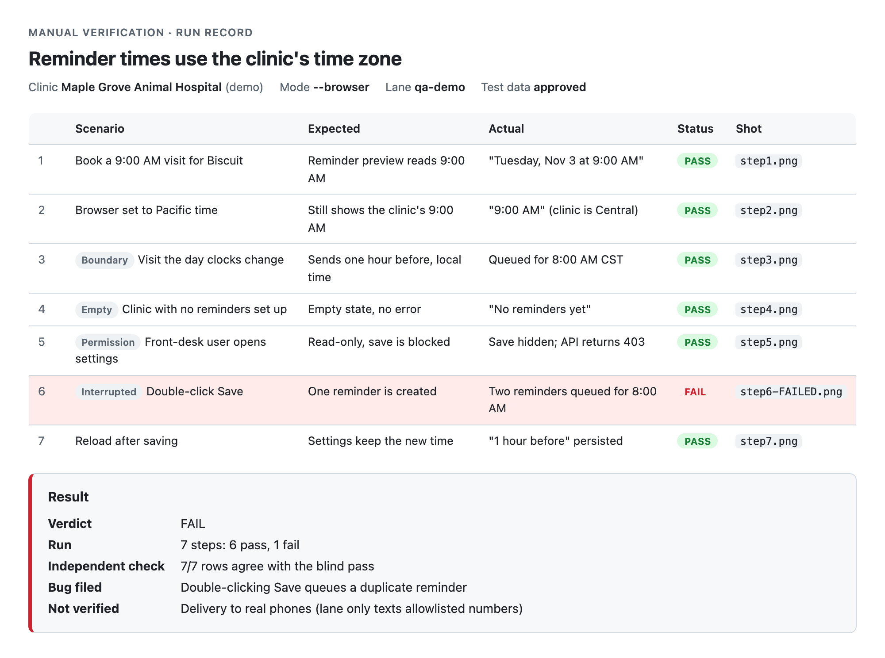

### Talena England

<picture>
  <source media="(prefers-color-scheme: dark)" srcset="2026-stats-dark.svg">
  <source media="(prefers-color-scheme: light)" srcset="2026-stats-light.svg">
  
</picture>

#### Projects I'm proud of

<b>Watchdog</b> · Otto's internal home for automated test results

 

Every automated test suite at Otto reports its runs in from CI, and Watchdog turns them into one place to see what's passing, what's flaky and what actually broke. I led its rebrand and built most of what it does today: automatic failure triage, lane-only failure callouts, flaky and broken tests that file their own tickets (which retired our Slack failure alerts), starting runs from the UI, feature coverage, test documentation, a redesigned run detail page and dark mode.

<picture>
  <source media="(prefers-color-scheme: dark)" srcset="assets/watchdog/history-dark.png">
  <source media="(prefers-color-scheme: light)" srcset="assets/watchdog/history-light.png">
  
</picture>

More screenshots

 

<table>
  <tr>
    <td colspan="2"><picture>
  <source media="(prefers-color-scheme: dark)" srcset="assets/watchdog/detail-dark.png">
  <source media="(prefers-color-scheme: light)" srcset="assets/watchdog/detail-light.png">
  
</picture> Run detail: auto failure reason and lane-only failures</td>
  </tr>
  <tr>
    <td width="50%"><picture>
  <source media="(prefers-color-scheme: dark)" srcset="assets/watchdog/filtered-dark.png">
  <source media="(prefers-color-scheme: light)" srcset="assets/watchdog/filtered-light.png">
  
</picture> Test history, filtered to auto-tagged runs</td>
    <td width="50%"><picture>
  <source media="(prefers-color-scheme: dark)" srcset="assets/watchdog/reports-dark.png">
  <source media="(prefers-color-scheme: light)" srcset="assets/watchdog/reports-light.png">
  
</picture> Reports: runs by status, failures by reason</td>
  </tr>
  <tr>
    <td width="50%"><picture>
  <source media="(prefers-color-scheme: dark)" srcset="assets/watchdog/coverage-dark.png">
  <source media="(prefers-color-scheme: light)" srcset="assets/watchdog/coverage-light.png">
  
</picture> Feature coverage and gaps</td>
    <td width="50%"><picture>
  <source media="(prefers-color-scheme: dark)" srcset="assets/watchdog/docs-dark.png">
  <source media="(prefers-color-scheme: light)" srcset="assets/watchdog/docs-light.png">
  
</picture> Test documentation by feature</td>
  </tr>
</table>

Screenshots run on made-up demo data. Watchdog is internal, so its code and data stay private.

<b>QA skills for Claude Code</b> · AI workflows that help Otto's QA team test faster

 

Otto's engineering team shares a workspace of Claude Code skills. I built most of its QA side: four skills I created and two I extended. Together they take a ticket from the first read through to a verified fix.

| Skill | What it does | My part |
|---|---|---|
| **Write QA notes** | Drafts a ticket's testing steps in the team's QA format | Created |
| **QA task research** | Finds every branch, PR and code change behind a ticket and explains it before testing starts | Created |
| **Fix E2E tests** | Traces a failing CI run or Playwright trace to its root cause and a fix, then checks the fix on fresh runs instead of retries | Created |
| **Write E2E test** | Writes new Playwright tests that follow each suite's own patterns | Created |
| **Manual verification** | Runs a QA plan step by step and records pass/fail with screenshots | Added a Flow browser driver (including two-user scenarios), a blind QA pass, and an approval gate for test data |
| **Verify test coverage** | Compares a ticket's changes against unit and E2E tests and names the gaps | Connected it to Watchdog's feature coverage |

I also made all of them work with both of Otto's E2E suites, and I keep their docs in step with how the suites actually run.

<picture>
  <source media="(prefers-color-scheme: dark)" srcset="assets/qa-skills/manual-verification-dark.png">
  <source media="(prefers-color-scheme: light)" srcset="assets/qa-skills/manual-verification-light.png">
  
</picture>

A manual verification run record, on made-up demo data. The workspace is internal, so its code stays private.

