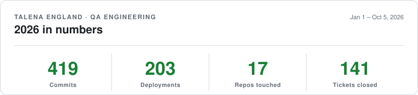
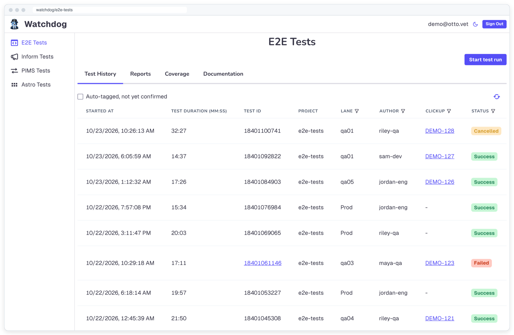
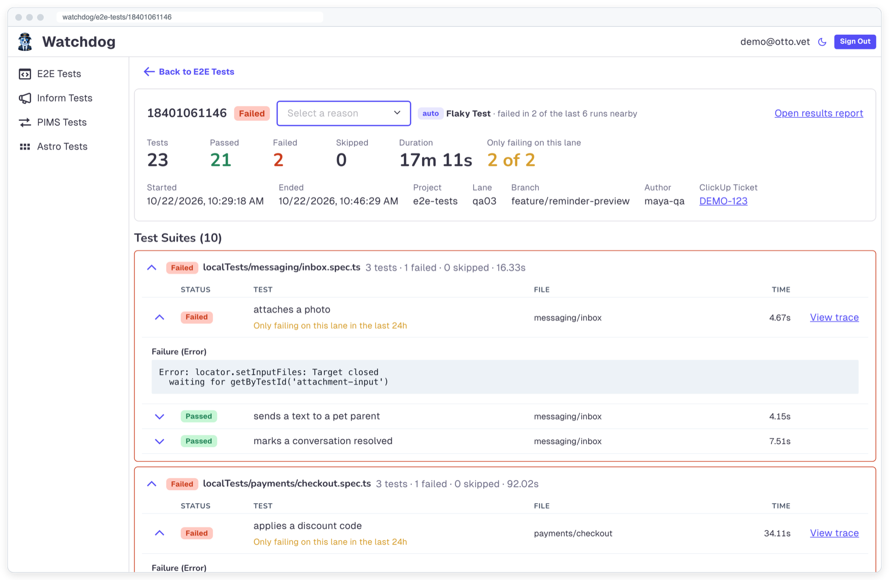
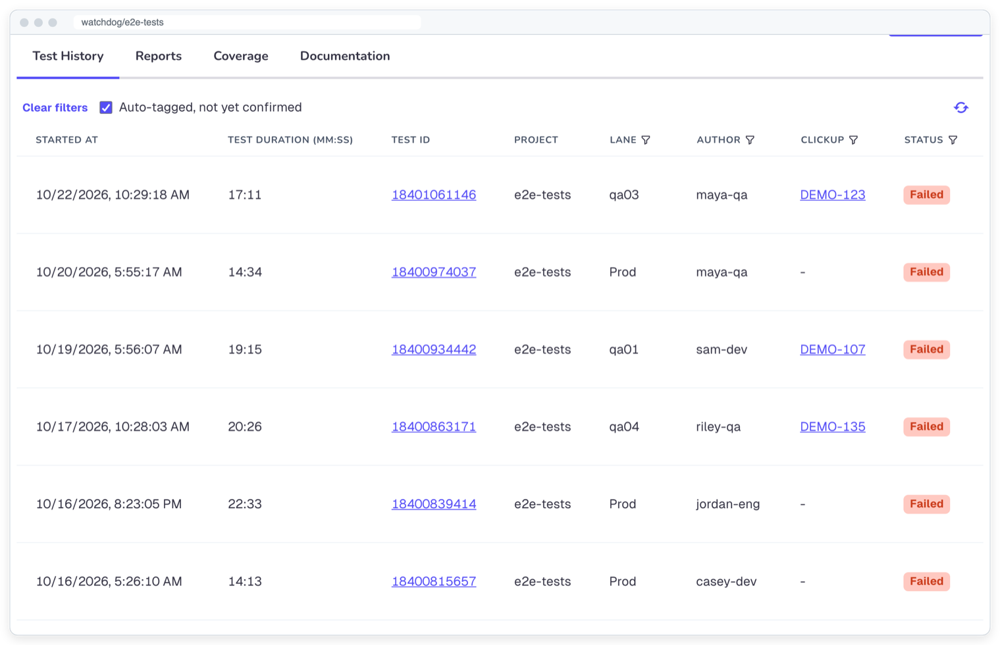
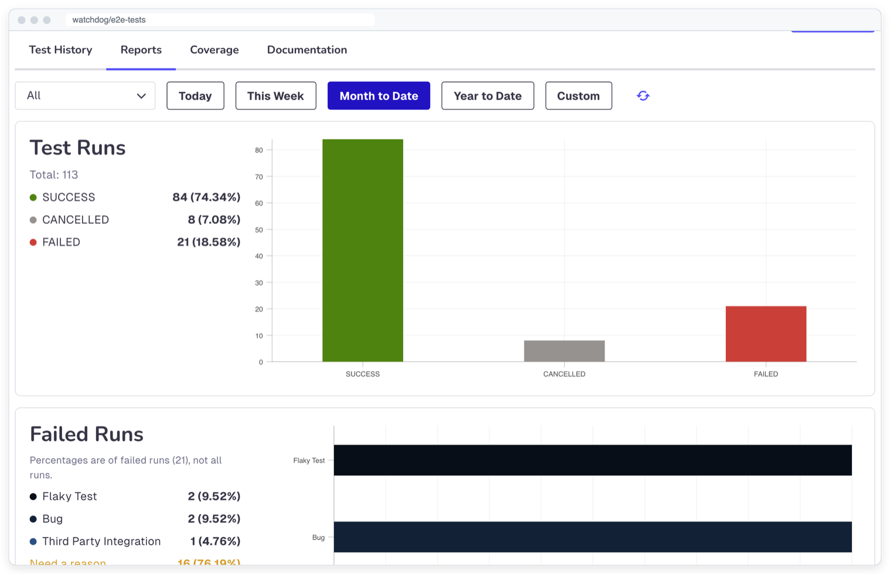
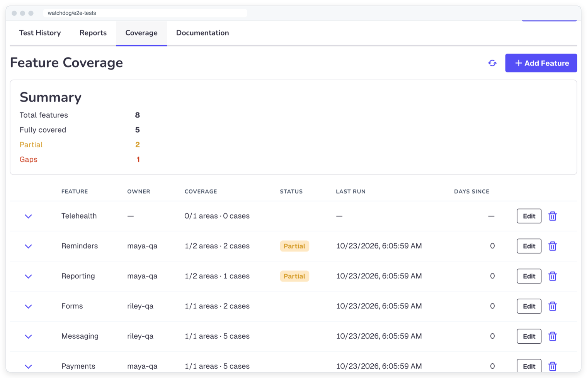
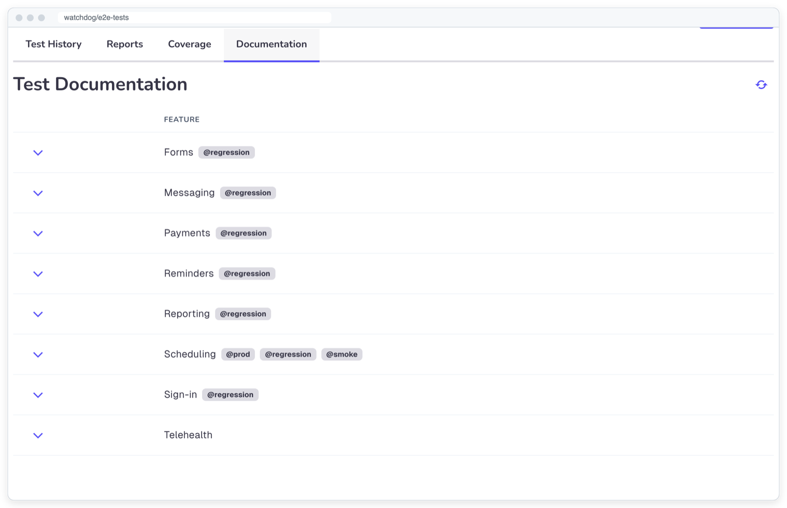

### Talena England

<picture>
  <source media="(prefers-color-scheme: dark)" srcset="2026-stats-dark.svg">
  <source media="(prefers-color-scheme: light)" srcset="2026-stats-light.svg">
  
</picture>

#### Projects I'm proud of

<b>Watchdog</b> · Otto's internal home for automated test results

 

Every automated test suite at Otto reports its runs in from CI, and Watchdog turns them into one place to see what's passing, what's flaky and what actually broke. I led its rebrand and built most of what it does today: automatic failure triage, lane-only failure callouts, flaky and broken tests that file their own tickets (which retired our Slack failure alerts), starting runs from the UI, feature coverage, test documentation, a redesigned run detail page and dark mode.

<picture>
  <source media="(prefers-color-scheme: dark)" srcset="assets/watchdog/history-dark.png">
  <source media="(prefers-color-scheme: light)" srcset="assets/watchdog/history-light.png">
  
</picture>

More screenshots

 

<table>
  <tr>
    <td colspan="2"><picture>
  <source media="(prefers-color-scheme: dark)" srcset="assets/watchdog/detail-dark.png">
  <source media="(prefers-color-scheme: light)" srcset="assets/watchdog/detail-light.png">
  
</picture> Run detail: auto failure reason and lane-only failures</td>
  </tr>
  <tr>
    <td width="50%"><picture>
  <source media="(prefers-color-scheme: dark)" srcset="assets/watchdog/filtered-dark.png">
  <source media="(prefers-color-scheme: light)" srcset="assets/watchdog/filtered-light.png">
  
</picture> Test history, filtered to auto-tagged runs</td>
    <td width="50%"><picture>
  <source media="(prefers-color-scheme: dark)" srcset="assets/watchdog/reports-dark.png">
  <source media="(prefers-color-scheme: light)" srcset="assets/watchdog/reports-light.png">
  
</picture> Reports: runs by status, failures by reason</td>
  </tr>
  <tr>
    <td width="50%"><picture>
  <source media="(prefers-color-scheme: dark)" srcset="assets/watchdog/coverage-dark.png">
  <source media="(prefers-color-scheme: light)" srcset="assets/watchdog/coverage-light.png">
  
</picture> Feature coverage and gaps</td>
    <td width="50%"><picture>
  <source media="(prefers-color-scheme: dark)" srcset="assets/watchdog/docs-dark.png">
  <source media="(prefers-color-scheme: light)" srcset="assets/watchdog/docs-light.png">
  
</picture> Test documentation by feature</td>
  </tr>
</table>

Screenshots run on made-up demo data. Watchdog is internal, so its code and data stay private.

